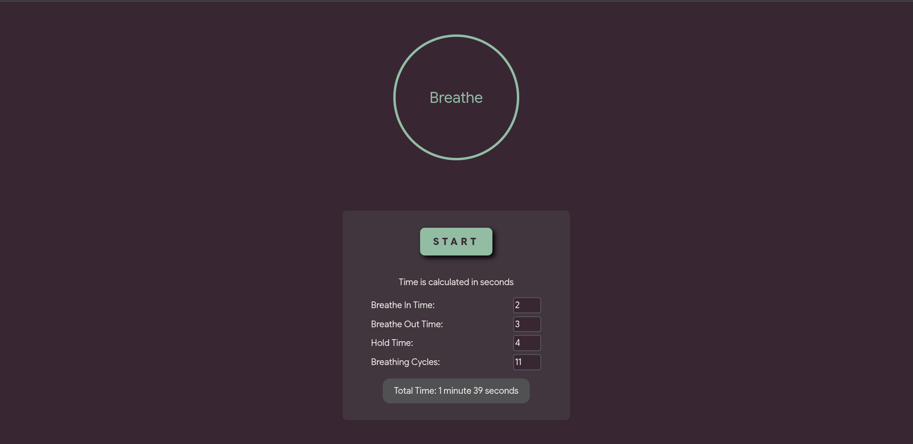

# Buteyko Breathing Timer

An interval timer for buteyko breathing exercises.

## Features

- An animated timer which moves as you breathe in and out
- A form which lets you customize each part of the breathing exercise
- A start button which starts the timer with values from the form
- A pause button which reverts your timer to the last breathe in time
- A restart button that renders the form again

## Tech Stach

💻 Languages: JavaScript
⚙️ Frameworks: React
